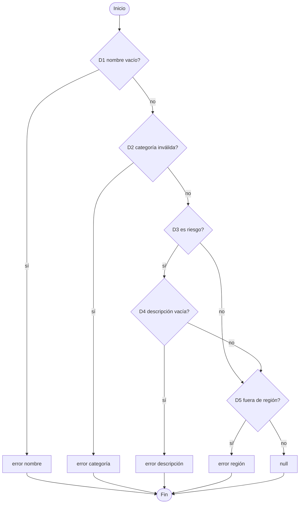

# Pruebas de caja blanca — DocenGo

Cada función con lógica tiene sus caminos independientes calculados con la
complejidad ciclomática **V(G) = decisiones + 1**. Cada camino tiene al menos
una prueba automática (Jest) con un identificador `CB-XXX-n`.

- Las pruebas viven en `__tests__/`.
- La lógica de `src/lib/` debe tener **100 % de ramas cubiertas** (`npm run test:cobertura`).
- ESLint rechaza funciones con V(G) mayor que 10.
- Cada Pull Request que agregue lógica agrega aquí su sección.

---

## 1. Validación del registro (RF-05) — `src/lib/validacion.ts`

**`validarRegistro(nombre, correo, contrasena)`** — 3 decisiones → **V(G) = 4**

| Caso | Camino | Resultado esperado |
|---|---|---|
| CB-VAL-1 | Nombre vacío | "Escribe tu nombre." |
| CB-VAL-2 | Correo inválido | "Escribe un correo válido." |
| CB-VAL-3 | Contraseña de menos de 8 caracteres | "La contraseña debe tener al menos 8 caracteres." |
| CB-VAL-4 | Todo correcto | `null` |

**`correoValido(correo)`** — se prueban ambos resultados de la expresión regular.

| Caso | Entrada | Resultado |
|---|---|---|
| CB-VAL-5 | Correo correcto con espacios alrededor | `true` |
| CB-VAL-6 | Sin dominio, o con espacio en medio | `false` |

## 2. Contador de intentos (RF-06) — `src/lib/intentos.ts`

| Caso | Función | Qué se comprueba |
|---|---|---|
| CB-INT-1 | `registrarFallo` | 1.º y 2.º fallo no bloquean (`fallidos >= 3` falso) |
| CB-INT-2 | `registrarFallo` | El 3.er fallo bloquea (`fallidos >= 3` verdadero) |
| CB-INT-3 | `registrarFallo` | No modifica el estado original |
| CB-INT-4 | `intentosRestantes` | Quedan intentos (gana `3 - fallidos`) |
| CB-INT-5 | `intentosRestantes` | Nunca negativo (gana `0` en `Math.max`) |
| CB-INT-6 | `registrarExito` | Reinicia el contador |

## 3. Mensajes de error (RNF de usabilidad) — `src/lib/errores.ts`

**`mensajeDeError(codigo)`** — 2 decisiones (`codigo &&`, `||`) → **V(G) = 3**

| Caso | Entrada | Resultado |
|---|---|---|
| CB-ERR-1 | Código conocido | Su mensaje en español |
| CB-ERR-2 | Código desconocido | "Ocurrió un error. Intenta de nuevo." |
| CB-ERR-3 | Sin código | "Ocurrió un error. Intenta de nuevo." |

## 4. Distancias (RF-14, RF-17, RF-19) — `src/lib/geo.ts`

| Caso | Función | Qué se comprueba |
|---|---|---|
| CB-GEO-1 | `distanciaKm` (V(G) = 1) | Mismo punto da 0 |
| CB-GEO-2 | `distanciaKm` | Yuriria–Moroleón entre 8 y 14 km, y es simétrica |
| CB-GEO-3 | `filtrarPorDistancia` | Lista vacía: el ciclo no se ejecuta |
| CB-GEO-4 | `filtrarPorDistancia` | Un elemento dentro y otro fuera |
| CB-GEO-5 | `filtrarPorDistancia` | Valor límite: exactamente a `maxKm` sí entra |
| CB-GEO-6 | `ordenarPorCercania` | Ordena del más cercano al más lejano |
| CB-GEO-7 | `ordenarPorCercania` | No modifica el arreglo original |
| CB-GEO-8 | `formatearDistancia` (V(G) = 2) | Menos de 1 km → metros |
| CB-GEO-9 | `formatearDistancia` | 1 km o más → km |
| CB-GEO-10 | `formatearDistancia` | Valor límite: exactamente 1 km |

## 5. Banderas de función — `src/lib/flags.ts`

**`opcionesVisibles(opciones, flags)`** — 1 decisión compuesta (`!o.flag || flags[o.flag]`) → **V(G) = 2**,
con cobertura de condiciones múltiples = 3 casos.

| Caso | Entrada | Resultado |
|---|---|---|
| CB-FLG-1 | Opción sin flag | Se muestra |
| CB-FLG-2 | Opción con flag encendida | Se muestra |
| CB-FLG-3 | Opción con flag apagada | Se oculta |

## 6. Pantalla de inicio de sesión (RF-06) — `src/app/(auth)/login.tsx`

**`entrar()`** — **V(G) = 7** (pruebas en `__tests__/pantallas/login.test.tsx`)

| Caso | Camino |
|---|---|
| CB-LOG-1 | Cuenta bloqueada: un cuarto intento no llega a Firebase |
| CB-LOG-2 | Correo vacío: no llama a Firebase |
| CB-LOG-3 | Correo lleno y contraseña vacía: no llama a Firebase |
| CB-LOG-4 | Credenciales correctas: inicia sesión sin errores |
| CB-LOG-5 | Fallo: avisa los intentos restantes |
| CB-LOG-6 | Tercer fallo: bloquea la cuenta |
| CB-LOG-7 | Un inicio exitoso reinicia el contador |
| CB-LOG-8 | Error sin código: mensaje genérico |
| CB-LOG-9 | Mientras Firebase responde: indicador en lugar de "Entrar" |

## 7. Alertas (RF-30) — `src/lib/alertas.ts`

**`validarAlerta(borrador)`** — 5 decisiones → **V(G) = 6**

```
if (!tipo)                → 1
if (!nivel)               → 2
if (!localidad)           → 3
if (texto.length < 10)    → 4
if (texto.length > 280)   → 5
                    V(G) = 5 + 1 = 6
```

| Caso | Camino | Resultado esperado |
|---|---|---|
| CB-ALE-1 | Sin tipo | "Elige el tipo de alerta." |
| CB-ALE-2 | Sin nivel | "Elige el nivel de riesgo." |
| CB-ALE-3 | Sin localidad | "Elige la localidad." |
| CB-ALE-4 | Descripción de menos de 10 caracteres (los espacios no cuentan) | "Describe lo que pasó (mínimo 10 caracteres)." |
| CB-ALE-5 | Descripción de 281 caracteres | "La descripción no puede pasar de 280 caracteres." |
| CB-ALE-6 | Todo correcto, incluido el límite exacto de 280 | `null` |

**`armarAlerta(datos, coordenada, autorId, fecha)`** — sin decisiones → **V(G) = 1**

| Caso | Qué se comprueba |
|---|---|
| CB-ALE-7 | El documento lleva `autorId`, contadores en 0 y la descripción sin espacios sobrantes |

**Prueba manual (criterio del SRS):** registrar una alerta de cada nivel (alto, medio y bajo)
con una cuenta y verlas desde otra cuenta.

## 8. Confirmar y desmentir alertas (RF-34) — `src/lib/votos.ts`

Cada voto se guarda en `alertas/{alertaId}/votos/{uid}`. Como el id del documento es el uid,
cada docente tiene **un solo voto por alerta**: cambiar de opinión lo reemplaza y no lo duplica.
Las reglas de Firestore impiden que el autor vote su propia alerta y que alguien vote a nombre de otro.

**`contarVotos(votos)`** — 2 decisiones (`for`, `if`) → **V(G) = 3**

| Caso | Camino | Resultado esperado |
|---|---|---|
| CB-VOT-1 | Lista vacía: el ciclo no se ejecuta | 0 confirmaciones, 0 desmentidos |
| CB-VOT-2 | Votos mezclados: entra a ambos lados del `if` | 2 confirmaciones, 1 desmentido |

**`estadoAlerta(conteo)`** — 2 decisiones → **V(G) = 3**

| Caso | Camino | Resultado esperado |
|---|---|---|
| CB-VOT-3 | Nadie ha votado | Sin verificar |
| CB-VOT-4 | Más confirmaciones que desmentidos | Confirmada |
| CB-VOT-5 | Empate o más desmentidos | En duda |

**`puedeVotar(autorId, uid)`** — 1 decisión compuesta (`&&`) → **V(G) = 2**; condiciones múltiples = 3 casos

| Caso | Entrada | Resultado |
|---|---|---|
| CB-VOT-6 | Sin sesión / el autor / otro docente | `false` / `false` / `true` |

**`siguienteVoto(actual, elegido)`** — 1 decisión → **V(G) = 2**

| Caso | Entrada | Resultado |
|---|---|---|
| CB-VOT-7 | Mismo voto que ya tenía / el otro voto / sin voto previo | Se quita / se cambia / se guarda |

**Prueba manual (criterio del SRS):** con 3 cuentas, A crea una alerta, B confirma y C desmiente.
Después B cambia su voto: el conteo cambia sin que se dupliquen los votos. A no ve los botones en su alerta.

---

## 9. Salas del chat — `src/lib/salas.ts` (T-04, RF-21)

**Responsable:** Alexis Rodríguez Martínez
**Pruebas:** `__tests__/lib/salas.test.ts`

Una sala del chat comunitario es la combinación de una región piloto
(`Yuriria`, `Uriangato`, `Moroleón`) y un tema (`General`, `Escuela`,
`Ambiente laboral`, `Servicios básicos`, `Institucional`). Los mensajes se guardan
en la colección `mensajes` con el campo `sala = idSala(region, tema)`, y la pantalla
filtra con un solo `where('sala', '==', …)`, por lo que no requiere índice compuesto.

### Funciones

| Función | Decisiones | V(G) | Caminos independientes |
|---|---|---|---|
| `normalizar(texto)` (interna) | 0 | 1 | 1: quita acentos, pasa a minúsculas, recorta y cambia espacios por `-` |
| `idSala(region, tema)` | 0 | 1 | 1: `normalizar(region) + "__" + normalizar(tema)` |
| `tituloSala(region, tema)` | 0 | 1 | 1: `` `${region} · ${tema}` `` |

Ninguna función tiene `if`, `? :`, `&&` ni `||`; el único camino de cada una se cubre
con un caso. Se agregan casos extra para comprobar la propiedad que exige RF-21:
el mismo tema en regiones distintas debe ser una sala distinta.

### Casos de prueba

| ID | Función | Entrada | Resultado esperado | Camino |
|---|---|---|---|---|
| CB-SAL-1 | `idSala` (y `normalizar`) | `('Moroleón', 'Servicios básicos')` | `"moroleon__servicios-basicos"` | Único camino; acentos, mayúsculas y espacios normalizados |
| CB-SAL-2 | `idSala` | `('Uriangato', 'Escuela')` y `('Yuriria', 'Escuela')` | `"uriangato__escuela"`, distinto de `"yuriria__escuela"` | Único camino; aislamiento de salas por región |
| CB-SAL-3 | `tituloSala` | `('Moroleón', 'Escuela')` | `"Moroleón · Escuela"` | Único camino |

### Prueba manual (criterio del SRS, RF-21)

Con dos cuentas (A y B): A escribe en **Uriangato · Escuela**; B lo ve en
**Uriangato · Escuela** y **no** lo ve en **Yuriria · Escuela**.

### Hallazgos

Ninguno. Nota: los mensajes creados antes de T-04 tienen `sala` igual al nombre del
tema (p. ej. `"Escuela"`) y ya no aparecen en ninguna sala.

---

## 10. Respuestas del chat — `src/lib/respuestas.ts` (T-07, RF-22)

**Responsable:** Alexis Rodríguez Martínez
**Pruebas:** `__tests__/lib/respuestas.test.ts`

Al mantener presionado un mensaje y elegir **Responder**, el mensaje nuevo guarda en
`respuestaA` una copia breve (cita) del original: `{ id, autorNombre, texto }`. Así la
burbuja muestra la cita sin otra lectura a Firestore y la conserva aunque el original
se borre. El campo solo se agrega cuando se está respondiendo, porque Firestore
rechaza los campos `undefined`.

### Funciones

| Función | Decisiones | V(G) | Caminos independientes |
|---|---|---|---|
| `citaDe(mensaje)` | 1 (`texto.length > MAX_CITA`) | 2 | 1: texto de hasta 80 caracteres, se copia completo · 2: texto de más de 80 caracteres, se recorta y termina en `…` |

### Casos de prueba

| ID | Función | Entrada | Resultado esperado | Camino |
|---|---|---|---|---|
| CB-RES-1 | `citaDe` | `{ id: 'm1', autorNombre: 'Ana', texto: '  ¿Hay internet en la escuela?  ' }` | `{ id: 'm1', autorNombre: 'Ana', texto: '¿Hay internet en la escuela?' }` | 1 (condición falsa) |
| CB-RES-2 | `citaDe` | texto de 100 caracteres `a` | texto de 80 `a` + `…`; `id` y `autorNombre` sin cambios | 2 (condición verdadera) |

### Prueba manual (criterio del SRS, RF-22)

Con dos cuentas (A y B) en la misma sala: A publica una duda; B la mantiene presionada,
elige **Responder** y escribe la respuesta. Ambas cuentas ven la respuesta con la cita
de la duda de A. Al cambiar de sala con una respuesta en curso, la franja
"Respondiendo a…" desaparece.

### Hallazgos

Ninguno.

---

## 11. Reportes del chat — `src/lib/reportes.ts` (T-07, RF-25)

**Responsable:** Alexis Rodríguez Martínez
**Pruebas:** `__tests__/lib/reportes.test.ts`

Al mantener presionado un mensaje **ajeno** y elegir **Reportar**, se abre el formulario
`src/components/ReportarMensaje.tsx` con el motivo (uno de `MOTIVOS`: Spam, Ofensivo o
acoso, Información falsa, Datos personales, Otro) y un detalle opcional de máximo 300
caracteres. El reporte se guarda en la colección `reportes` con estado `pendiente`
(entidad *ReporteContenido* del SRS 6.1).

**Un reporte por persona por mensaje:** el id del documento es
`idReporte(idMensaje, uid)` = `"<idMensaje>_<uid>"`. La app revisa primero si ya existe
(muestra "Ya reportaste este mensaje"), y además `firestore.rules` exige ese id al crear
y no permite que quien reporta lo actualice. Por lo tanto, un segundo reporte nunca crea
otro documento ni sobrescribe el primero (RNF-03).

### Funciones

| Función | Decisiones | V(G) | Caminos independientes |
|---|---|---|---|
| `idReporte(mensajeId, uid)` | 0 | 1 | 1: `` `${mensajeId}_${uid}` `` |
| `validarReporte(motivo, detalle)` | 2 (`!MOTIVOS.includes(motivo)`, `detalle.trim().length > MAX_DETALLE`) | 3 | 1: motivo fuera de la lista → `"Elige un motivo."` · 2: motivo válido y detalle largo → mensaje de máximo 300 · 3: motivo válido y detalle correcto → `null` |

### Casos de prueba

| ID | Función | Entrada | Resultado esperado | Camino |
|---|---|---|---|---|
| CB-REP-1 | `validarReporte` | `('', '')` y `('Me cae mal', '')` | `"Elige un motivo."` | 1 |
| CB-REP-2 | `validarReporte` | `('Spam', 301 caracteres)` | `"El detalle debe tener máximo 300 caracteres."` | 2 |
| CB-REP-3 | `validarReporte` | `('Otro', '')` y `('Información falsa', 300 caracteres)` | `null` (detalle opcional; valor límite aceptado) | 3 |
| CB-REP-4 | `idReporte` | `('msg1', 'uidA')` dos veces y `('msg1', 'uidB')` | `"msg1_uidA"`, igual en ambas llamadas y distinto del de `uidB` | Único camino; un id por persona y mensaje |

### Reglas de Firestore (`firestore.rules`, bloque `reportes`)

| Operación | Quién | Condición |
|---|---|---|
| `get` | quien reportó o admin | `resource == null` (para saber si ya reportó) o `autorId == uid` |
| `list` | solo admin | — |
| `create` | cualquier docente | `autorId == uid`, id = `contenidoId + '_' + uid`, `estado == 'pendiente'`, `motivo` en la lista, `detalle.size() <= 300` |
| `update`, `delete` | solo admin | moderación (RF-45) |

La regla genérica `/{coleccion}/{id}` excluye `reportes` (`coleccion != 'reportes'`),
porque Firestore combina las reglas con OR y, sin la exclusión, cualquier docente podría
leer todos los reportes.

### Prueba manual (criterio del SRS, RF-25)

1. B mantiene presionado un mensaje de A, elige **Reportar**, escoge un motivo y envía.
   En Firebase Console aparece `reportes/<idMensaje>_<uidB>` con `estado: "pendiente"`.
2. B reporta el mismo mensaje otra vez: la app muestra "Ya reportaste este mensaje" y en
   `reportes` sigue habiendo **un solo** documento.
3. En un mensaje propio no aparece la opción **Reportar**.
4. Sin conexión, el envío muestra el error y conserva motivo y detalle para reintentar (RNF-20).

### Hallazgos

- El camino 2 de `validarReporte` no se alcanza desde la pantalla, porque el `TextInput`
  tiene `maxLength={300}`. Se conserva como validación de respaldo (RNF-04), y la regla
  de Firestore repite el límite del lado del servidor.
- La regla `get` con `resource == null` permite a un docente saber si **no** existe un
  reporte con un id dado. Para eso tendría que conocer el uid de otra persona; el riesgo
  se considera aceptable.
- La lista de motivos está repetida en `src/lib/reportes.ts` y en `firestore.rules`. Si
  cambia una, hay que cambiar la otra.

---

## 12. Lugares destacados — `src/lib/lugares.ts` (T-10, RF-26)

**Responsable:** Alexis Rodríguez Martínez
**Pruebas:** `__tests__/lib/lugares.test.ts`

Desde **Más → Lugares destacados** (`src/app/lugares/index.tsx`) se ve en tiempo real la
lista de lugares que recomienda la comunidad, del más reciente al más antiguo. El botón
**Publicar lugar** abre `src/app/lugares/nuevo.tsx`, que pide:

- **Nombre** (máximo 60 caracteres).
- **Categoría**, una de `CATEGORIAS_LUGAR`: Comida, Cafetería, Parque o recreación,
  Cultura, Compras, Otro.
- **Localidad**, una de `REGIONES` (`src/lib/salas.ts`): Yuriria, Uriangato, Moroleón.
- **Descripción** (máximo 300 caracteres).
- **Ubicación**: se toca el minimapa para colocar el pin, o se usa el botón
  "Usar mi ubicación" (`src/components/SelectorUbicacion.tsx`). Sin permiso de ubicación
  se puede seguir tocando el mapa (RF-15).

El lugar se guarda en la colección `lugares` con `autorId`, `autorNombre` y `fecha`.
Desde T-13, el formulario vive en `src/components/FormularioLugar.tsx` (lo comparten
Publicar y Editar) y `lugares` tiene su propio bloque en `firestore.rules`.

### Funciones

| Función | Decisiones | V(G) | Caminos independientes |
|---|---|---|---|
| `validarLugar(borrador)` | 5 (`!nombre.trim()`, `!CATEGORIAS_LUGAR.includes(categoria)`, `!REGIONES.includes(localidad)`, `!descripcion.trim()`, `!ubicacion`) | 6 | 1: nombre vacío · 2: categoría inválida · 3: localidad inválida · 4: descripción vacía · 5: sin ubicación · 6: todo correcto → `null` |

### Casos de prueba

Cada caso parte de un borrador válido y cambia solo el campo que prueba.

| ID | Entrada | Resultado esperado | Camino |
|---|---|---|---|
| CB-LUG-1 | `nombre: ''` y `nombre: '   '` | `"Escribe el nombre del lugar."` | 1 |
| CB-LUG-2 | `categoria: ''` y `categoria: 'Antro'` | `"Elige una categoría."` | 2 |
| CB-LUG-3 | `localidad: ''` y `localidad: 'Celaya'` | `"Elige una localidad."` | 3 |
| CB-LUG-4 | `descripcion: ''` y `descripcion: '  \n '` | `"Escribe una descripción."` | 4 |
| CB-LUG-5 | `ubicacion: null` | `"Marca la ubicación en el mapa."` | 5 |
| CB-LUG-6 | Borrador válido, y con `categoria: 'Otro'`, `localidad: 'Yuriria'` | `null` | 6 |

### Prueba manual (criterio del SRS, RF-26)

1. A publica al menos 5 lugares (uno o más por localidad, con categorías distintas).
   Uno con el minimapa y otro con "Usar mi ubicación".
2. B, con otra cuenta, abre **Lugares destacados** y ve los 5 lugares sin recargar.
   En Firebase Console cada documento de `lugares` tiene `latitud`, `longitud`,
   `autorId` y `autorNombre`.
3. Si A intenta publicar sin llenar un campo, aparece el mensaje de ese campo y no se guarda nada.
4. Sin conexión, publicar muestra el error y conserva los datos para reintentar (RNF-20).
5. Negando el permiso de ubicación, "Usar mi ubicación" muestra el aviso y el mapa se puede seguir tocando.

### Hallazgos

- Los máximos de nombre (60) y descripción (300) se aplican con `maxLength` en el
  formulario, no en `validarLugar`. Así no queda un camino inalcanzable como el camino 2
  de `validarReporte`. Desde T-13, `firestore.rules` repite estos límites y las listas
  del lado del servidor (función `lugarValido()`, ver la sección "Valoraciones de lugares").
- La pantalla repite `!ubicacion` después de `validarLugar` solo para que TypeScript sepa
  que la ubicación no es `null`. No cambia el comportamiento.
- No se revisa que el pin quede dentro de la región piloto. La localidad elegida sirve
  para filtrar (RF-27), pero un pin mal colocado no se detecta.

---

## 13. Filtros de lugares — `filtrarLugares` en `src/lib/lugares.ts` (T-13, RF-27)

**Responsable:** Alexis Rodríguez Martínez
**Pruebas:** `__tests__/lib/filtros-lugares.test.ts`

La lista `src/app/lugares/index.tsx` tiene dos filas de chips:

- **Localidad**: Todas, Yuriria, Uriangato y Moroleón.
- **Categoría**: Todas y las 6 de `CATEGORIAS_LUGAR`.

El filtro se aplica en la app sobre la lista que ya llega en tiempo real, así que no
requiere índices compuestos en Firestore. Si no hay resultados se muestra
"No hay lugares con esos filtros.".

### Funciones

| Función | Decisiones | V(G) | Caminos independientes |
|---|---|---|---|
| `filtrarLugares(lugares, localidad, categoria)` | 2 (`localidad !== TODAS`, `categoria !== TODAS`) | 3 | 1: ningún filtro · 2: solo localidad · 3: solo categoría |

Hay un cuarto caso con **ambos** filtros (los dos `if` verdaderos). Es el uso real en la
pantalla y además prueba el resultado vacío.

### Casos de prueba

Los casos usan 4 lugares de prueba:

1. Moroleón, Cafetería
2. Moroleón, Comida
3. Yuriria, Cafetería
4. Uriangato, Cultura

| ID | Entrada | Resultado esperado | Camino |
|---|---|---|---|
| CB-FLU-1 | `(Todas, Todas)` | Los 4 lugares, sin cambios | 1 |
| CB-FLU-2 | `('Moroleón', Todas)` | Lugares 1 y 2 | 2 |
| CB-FLU-3 | `(Todas, 'Cafetería')` | Lugares 1 y 3 | 3 |
| CB-FLU-4 | `('Yuriria', 'Cafetería')` y `('Uriangato', 'Compras')` | Lugar 3, y `[]` | 2 + 3 (ambos filtros) |

### Prueba manual (criterio del SRS, RF-27)

1. Con al menos 5 lugares de prueba en varias localidades y categorías, elegir cada
   localidad y comprobar que solo aparecen los lugares de esa localidad.
2. Elegir una categoría y combinarla con una localidad. Al volver a **Todas** aparece la
   lista completa.
3. Una combinación sin lugares muestra "No hay lugares con esos filtros.".

### Hallazgos

- Ninguno.

---

## 14. Valoraciones de lugares — `src/lib/valoraciones.ts` (T-13, RF-28 y RF-29)

**Responsable:** Alexis Rodríguez Martínez
**Pruebas:** `__tests__/lib/valoraciones.test.ts`

Al tocar un lugar se abre su ficha, `src/app/lugares/[id].tsx`. La ficha muestra la
descripción, un minimapa con el pin, el promedio (`textoPromedio`) y los comentarios en
tiempo real. Lo que se puede hacer depende de quién la abra:

- **Si no eres el autor**, ves el formulario `src/components/ValorarLugar.tsx`: de 1 a 5
  estrellas y un comentario opcional de máximo 300 caracteres.
  - La valoración se guarda en `lugares/{lugarId}/valoraciones/{uid}`.
  - Como el id del documento es tu uid, **si vuelves a valorar se reemplaza tu valoración
    anterior**. Hay una sola por persona por lugar.
- **Si eres el autor** (`puedeEditar`), no ves el formulario de valoración. En su lugar ves:
  - **Editar**, que abre `src/app/lugares/editar/[id].tsx` con el mismo formulario de Publicar.
  - **Eliminar**, que pide confirmación.

El promedio se calcula en la app a partir de la subcolección. No se guarda en el documento
del lugar porque quien valora no es el autor y la regla no le permite modificarlo.

### Funciones

| Función | Decisiones | V(G) | Caminos independientes |
|---|---|---|---|
| `promedioEstrellas(valoraciones)` | 1 (`length === 0`) | 2 | 1: sin valoraciones → `null` · 2: promedio redondeado a 1 decimal |
| `textoPromedio(promedio, total)` | 2 (`promedio === null`, `total === 1`) | 3 | 1: "Sin valoraciones" · 2: singular · 3: plural |
| `validarEstrellas(estrellas)` | 1 (`!entero \|\| < 1 \|\| > 5`) | 2 | 1: inválidas → mensaje · 2: válidas → `null` |
| `puedeEditar(autorId, uid)` | 0 | 1 | 1: `uid !== undefined && autorId === uid` |

`validarEstrellas` tiene una sola decisión con tres condiciones. CB-VLR-7 prueba cada
condición por separado (0, 6 y 3.5) para tener cobertura de condiciones múltiples.

### Casos de prueba

| ID | Función | Entrada | Resultado esperado | Camino |
|---|---|---|---|---|
| CB-VLR-1 | `promedioEstrellas` | `[]` | `null` | 1 |
| CB-VLR-2 | `promedioEstrellas` | A da 5, B da 3 | `4` (★ 4.0) | 2 |
| CB-VLR-3 | `promedioEstrellas` | A cambia a 4: `[4, 3]`; y `[5, 4, 4]` | `3.5` (siguen siendo 2 votos); `4.3` | 2 (redondeo) |
| CB-VLR-4 | `textoPromedio` | `(null, 0)` | `"Sin valoraciones"` | 1 |
| CB-VLR-5 | `textoPromedio` | `(5, 1)` | `"★ 5.0 · 1 valoración"` | 2 |
| CB-VLR-6 | `textoPromedio` | `(3.5, 2)` | `"★ 3.5 · 2 valoraciones"` | 3 |
| CB-VLR-7 | `validarEstrellas` | `0`, `6` y `3.5` | `"Elige de 1 a 5 estrellas."` | 1 |
| CB-VLR-8 | `validarEstrellas` | `1` y `5` | `null` (valores límite) | 2 |
| CB-VLR-9 | `puedeEditar` | `('uidA','uidA')`, `('uidA','uidB')`, `('uidA', undefined)` | `true`, `false`, `false` | Único camino |

### Reglas de Firestore (`firestore.rules`, bloque `lugares`)

La regla genérica `/{coleccion}/{id}` excluye `reportes` y `lugares`. Firestore combina
las reglas con OR, así que sin esa exclusión la regla genérica permitiría editar un lugar
sin validar sus campos.

| Ruta | Operación | Quién | Condición |
|---|---|---|---|
| `lugares/{id}` | `read` | cualquier docente | con sesión |
| `lugares/{id}` | `create` | cualquier docente | `autorId == uid` y `lugarValido()` |
| `lugares/{id}` | `update` | autor o admin | autor: `lugarValido()` y `autorId` sin cambios · admin: moderación (RF-45) |
| `lugares/{id}` | `delete` | autor o admin | — |
| `…/valoraciones/{uid}` | `read` | cualquier docente | con sesión |
| `…/valoraciones/{uid}` | `create`, `update` | quien valora | id = su uid, `autorId == uid`, `estrellas` entero de 1 a 5, `comentario.size() <= 300` y **no es el autor del lugar** (`get()` del lugar) |
| `…/valoraciones/{uid}` | `delete` | quien valoró o admin | — |

`lugarValido()` revisa los campos así:

| Campo | Condición |
|---|---|
| `nombre` | no vacío, máximo 60 caracteres |
| `categoria` | una de `CATEGORIAS_LUGAR` |
| `localidad` | una de la región piloto |
| `descripcion` | no vacía, máximo 300 caracteres |
| `latitud`, `longitud` | numéricas |

### Prueba manual (criterio del SRS, RF-28 y RF-29)

Se necesitan tres cuentas: A, B y C.

1. A publica un lugar. B le da 5 estrellas y C le da 3. La ficha muestra
   **★ 4.0 · 2 valoraciones**.
2. B cambia su valoración a 4. La ficha muestra **★ 3.5 · 2 valoraciones**, no 3 votos.
   En Firebase Console sigue habiendo un solo documento `valoraciones/<uidB>`.
3. En la ficha de su propio lugar, A no ve "Valora este lugar"; ve **Editar** y **Eliminar**.
4. A edita la descripción. B ve el cambio en la ficha y en la lista sin recargar.
5. B no ve Editar ni Eliminar en el lugar de A. Si abre `/lugares/editar/<id>` ve
   "Solo el autor puede editar este lugar.", y aunque intentara guardar, la regla
   rechazaría la escritura.
6. A elimina el lugar, confirma en el aviso, y el lugar desaparece de la lista de B.
7. Sin conexión, guardar una valoración o una edición muestra el error y conserva los
   datos escritos (RNF-20).

### Hallazgos

- **Valoraciones huérfanas:** Firestore no borra las subcolecciones al eliminar un
  documento. Cuando se elimina un lugar, sus valoraciones se quedan en
  `lugares/{id}/valoraciones`. La app ya no las muestra, pero cualquier persona con sesión
  que conozca la ruta todavía puede leerlas. Se acepta para el piloto y su limpieza queda
  para la moderación (RF-45).
- Las listas de categorías y localidades y los límites de largo están escritos dos veces:
  en `src/lib/lugares.ts` y en `firestore.rules`, igual que los motivos de reportes. Si se
  cambia uno, hay que cambiar el otro.
- El admin puede editar un lugar sin pasar por `lugarValido()`. Es intencional, para
  moderar, y se revisará en T-28 (seguridad).
- La regla de valoraciones hace un `get()` del lugar en cada escritura, lo que suma una
  lectura facturable. Si el lugar ya fue eliminado, la escritura se rechaza.

---

## 15. Notificaciones — `src/lib/notificaciones.ts` (T-16, RF-24)

**Responsable:** Alexis Rodríguez Martínez
**Pruebas:** `__tests__/lib/notificaciones.test.ts`

Cuando alguien envía un mensaje en el chat, se avisa a los **participantes de esa sala**: las
personas que alguna vez escribieron en ella. Al enviar, la sala se agrega a
`avisos/{uid}.salas` con `arrayUnion`. Los destinatarios salen de una sola consulta,
`where('salas', 'array-contains', sala)`, que no necesita índice compuesto. Nunca se avisa a
quien envía, ni a quien ya tiene esa sala abierta en pantalla.

Al tocar el aviso se abre `/chat?region=…&tema=…`. La pantalla valida los parámetros con
`salaDeNotificacion` antes de cambiar de sala.

### Dos modos, con detección automática

`src/components/Notificaciones.tsx` se monta en `src/app/_layout.tsx`, pide el permiso y elige
el modo:

| Modo | Cuándo | Cómo funciona | Limitación |
|---|---|---|---|
| **A · push remoto** | Hay token de Expo (development build con `extra.eas.projectId` en `app.json`) | El token se guarda en `avisos/{uid}.pushToken`. Quien envía hace `POST https://exp.host/--/api/v2/push/send` con los tokens de los participantes. | Necesita EAS y, en Android, credenciales de FCM V1. |
| **B · local** | No hay token. En **Expo Go para Android** el push remoto no existe desde el SDK 53; también aplica si no hay `projectId` | La app escucha los mensajes con `fecha >` el momento en que abrió y muestra una notificación local con `scheduleNotificationAsync`. | Solo funciona mientras el JS sigue vivo: con la app abierta en otra pestaña o sala, o unos momentos después de mandarla a segundo plano. **Con la app cerrada no llega nada.** |

Los modos se pueden mezclar. Quien está en Expo Go siempre intenta enviar push a los
participantes que tienen token, así que alguien con un development build sí recibe avisos de
alguien en Expo Go.

### Funciones

| Función | Decisiones | V(G) | Caminos independientes |
|---|---|---|---|
| `tokenValido(token)` | 1 (`typeof === 'string' && regex`) | 2 | 1: token de Expo → `true` · 2: otro valor → `false` |
| `destinatarios(registros, remitenteUid)` | 2 (`for`, `id !== remitente && tokenValido`) | 3 | 1: lista vacía · 2: usuario descartado · 3: token agregado (el `Set` quita repetidos) |
| `avisoDe(mensaje)` | 1 (`body.length > MAX_CUERPO`) | 2 | 1: cuerpo corto · 2: cuerpo recortado con "…" |
| `salaDeNotificacion(data)` | 2 (no es objeto, región o tema inválidos) | 3 | 1: no es objeto → `null` · 2: sala inexistente → `null` · 3: sala real → `{ region, tema }` |
| `debeAvisar(m, uid, salaVisible, misSalas)` | 2 (mensaje propio, sala visible) | 3 | 1: propio → `false` · 2: sala abierta → `false` · 3: `misSalas.includes(sala)` |

### Casos de prueba

| ID | Función | Entrada | Resultado esperado | Caminos |
|---|---|---|---|---|
| CB-NOT-1 | `tokenValido` | `ExponentPushToken[aaa]`, `ExpoPushToken[bbb]` · `undefined`, `''`, `ExponentPushToken[]`, `fcm:abc123` | `true` · `false` | 1, 2 |
| CB-NOT-2 | `destinatarios` | Remitente con token, dos cuentas con el mismo token, una sin token, una con basura y una válida · lista vacía | `[TOKEN_A, TOKEN_B]` · `[]` | 1, 2, 3 |
| CB-NOT-3 | `avisoDe` | Ana, "  ¿Hay junta?  " en Moroleón · Escuela · texto de 200 caracteres | `"Moroleón · Escuela"`, `"Ana: ¿Hay junta?"`, `data` con la sala · cuerpo de 100 caracteres + "…" | 1, 2 |
| CB-NOT-4 | `salaDeNotificacion` | `{Uriangato, Escuela, t}` · `null`, `'Uriangato'` · Celaya, tema "Fiestas", `{}` | `{ region, tema }` sin `t` · `null` · `null` | 3, 1, 2 |
| CB-NOT-5 | `debeAvisar` | Mensaje propio · de la sala abierta · de una sala ajena · de mi sala sin nada abierto · de mi sala con otra sala abierta | `false`, `false`, `false`, `true`, `true` | 1, 2, 3 |

### Prueba manual (criterio del SRS, RF-24)

**Plan B en Expo Go.** Se necesitan dos teléfonos, A y B, y que **los dos hayan escrito antes**
en Moroleón · Escuela.

1. B acepta el permiso de notificaciones y se queda en otra pestaña (Mapa) u otra sala.
2. A escribe en Moroleón · Escuela. En menos de 10 s, a B le llega
   "Moroleón · Escuela — A: …".
3. B toca la notificación y se abre el chat en Moroleón · Escuela.
4. Con B dentro de Moroleón · Escuela, A escribe de nuevo: **no** llega aviso.
5. B minimiza la app y A escribe enseguida: el aviso llega mientras el sistema no suspenda
   la app. Hay que anotar cuántos segundos aguanta.
6. Si B niega el permiso, el chat funciona igual y no hay avisos.

**Plan A en el development build.** Mismos pasos, y además, con la app de B **cerrada**, el aviso
llega y al tocarlo se abre la sala. En Firebase Console, `avisos/<uidB>` tiene `pushToken`
y `salas`.

### Hallazgos

- **El Plan B no cumple el criterio con la app cerrada.** En segundo plano solo funciona
  mientras Android o iOS no suspendan el JS. El criterio de menos de 10 s en segundo plano
  queda cubierto completamente solo con el Plan A, en el development build.
- **Los tokens se pueden leer.** `avisos` lo puede leer cualquiera con sesión, incluido
  `pushToken`, y la API de Expo acepta envíos sin autenticación. Alguien malintencionado
  podría mandar notificaciones falsas. La solución es enviar desde una Cloud Function, pero
  requiere el plan Blaze. Se acepta para el piloto (`docs/revision-seguridad.md`, H7).
- **Corregido en T-28:** las salas y el token estaban en `usuarios`, que cualquiera con sesión
  podía leer junto con el **correo** (RNF-05). Ahora viven en `avisos/{uid}` y `usuarios`
  solo lo lee su dueño o un admin. Como `avisos` se escribe con `actualizarOCrear` (`setDoc`
  con `merge`), también funciona para cuentas que no tienen documento en `usuarios`.
- **Relojes desincronizados.** El Plan B usa `fecha > inicio` con la hora de cada teléfono. Si
  el reloj de quien envía va atrasado, su mensaje puede no generar aviso.
- **Límite de la API de Expo.** Acepta máximo 100 mensajes por petición. En el piloto ninguna
  sala llega a tantos participantes, así que no se envía en partes.
- **Aviso esperado en la consola.** En Expo Go, `expo-notifications` escribe una advertencia
  de que el push remoto no está disponible. Es normal y confirma que se usa el Plan B.

---

## 16. `puedeEditar` (src/lib/permisos.ts), RF-13, RF-29 y RF-45

Decide si se muestran los botones **Editar** y **Eliminar**. Debe coincidir con la regla de Firestore `esAutor() || esAdmin()`: si la app y las reglas no coinciden, el usuario ve un botón que luego falla con `permission-denied`.

```ts
export function puedeEditar(autorId, actor) {
  if (!actor) return false;                                  // D1
  return actor.uid === autorId || actor.rol === 'admin';     // D2 (||)
}
```

**V(G) = 1 + `if` + `||` = 3.**

| Camino | Recorrido | Entrada | Resultado esperado | Prueba | Estado |
|---|---|---|---|---|---|
| C1 | D1 sí | sin sesión (`null`) | `false` | CB-PRM-1 | Pasa |
| C2 | D1 no, `uid === autorId` | el autor, rol docente | `true` (corto circuito del `\|\|`) | CB-PRM-2 | Pasa |
| C3 | D1 no, no es autor, es admin | otro uid, rol admin | `true` | CB-PRM-3 | Pasa |

Caso complementario (cobertura de condiciones): CB-PRM-4, ni autor ni admin → `false`.

---

## 17. Ficha de punto (RF-12): `contactoComoEnlace` y pantalla `punto/[id].tsx`

### 17.1 `contactoComoEnlace` (src/lib/contacto.ts)

```ts
export function contactoComoEnlace(contacto) {
  if (!contacto) return null;                                   // D1
  const digitos = contacto.replace(/\D/g, '');
  if (digitos.length === 10) return `tel:${digitos}`;           // D2
  if (contacto.includes('@')) return `mailto:${contacto.trim()}`; // D3
  return null;
}
```

**V(G) = 1 + 3 `if` = 4.**

| Camino | Recorrido | Entrada | Resultado esperado | Prueba | Estado |
|---|---|---|---|---|---|
| C1 | D1 sí | `undefined` o `''` | `null` | CB-CON-1 | Pasa |
| C2 | D1 no, D2 sí | `'445-123-4567'`, `'445 123 45 67'` | `'tel:4451234567'` | CB-CON-2 | Pasa |
| C3 | D2 no, D3 sí | `' renta@correo.com '` | `'mailto:renta@correo.com'` | CB-CON-3 | Pasa |
| C4 | D2 no, D3 no | `'Preguntar en la tienda'` | `null` | CB-CON-4 | Pasa |

Valor límite: CB-CON-5, 9 dígitos no se toma como teléfono.

### 17.2 Componente `Contenido` de la ficha (src/app/punto/[id].tsx)

```tsx
if (punto === undefined) return <Spinner/>;            // D1 cargando
if (punto === null) return <NoDisponible/>;            // D2 no existe
punto.descripcion || 'Sin descripción.'                // D3
punto.contacto ? <SeccionContacto/> : null             // D4
enlace ? <Boton/> : null                               // D5
enlace.startsWith('tel:') ? 'Llamar' : 'Escribir correo' // D6
editable ? <EditarPunto/> : null                       // D7 (agregada en T-02)
```

**V(G) = 1 + 7 = 8** (ESLint reporta 8). En T-01 era 7; T-02 agregó D7 para el botón **Editar punto**. Pruebas de componente con Firestore simulado (`jest.mock('../../src/services/db')`):

| Camino | Recorrido | Datos del punto | Resultado esperado | Prueba | Estado |
|---|---|---|---|---|---|
| C1 | D1 sí | todavía no llega | sin datos en pantalla | CB-FPT-4 | Pasa |
| C2 | D2 sí | no existe | "Este punto ya no está disponible." | CB-FPT-3 | Pasa |
| C3 | camino base: D3 con texto, D4 no, D5 no | con descripción, sin contacto | sin sección ni botón de contacto | CB-FPT-2 | Pasa |
| C4 | D4 sí, D5 sí, D6 tel | contacto `'445 123 4567'` | 4 datos + **Llamar** abre `tel:4451234567` | CB-FPT-1 | Pasa |
| C5 | D3 vacío, D6 correo | sin descripción, contacto correo | "Sin descripción." + **Escribir correo** | CB-FPT-5 | Pasa |
| C6 | D4 sí, D5 no | contacto `'Preguntar en la tienda'` | se muestra el texto, sin botón | CB-FPT-6 | Pasa |

| C7 | D7 sí (autor) | sesión del autor | aparece **Editar punto** y lleva a `/punto/editar/p1` | CB-FPT-7 | Pasa |
| C8 | D7 sí (admin) | sesión de admin, punto ajeno | aparece **Editar punto** | CB-FPT-9 | Pasa |

CB-FPT-8 confirma el lado falso de D7 con un docente que no es el autor. Las 9 pruebas cubren las 14 ramas (los dos lados de D1 a D7).

---

## 18. Registrar y editar puntos (RF-13)

### 18.1 `validarPunto` (src/lib/puntos.ts)

```ts
if (!p.nombre.trim()) return 'Escribe el nombre del punto.';                          // D1
if (!CATEGORIAS_PUNTO.includes(p.categoria)) return 'Elige una categoría.';            // D2
if (p.categoria === 'riesgo' && !p.descripcion.trim()) return 'Describe por qué...';  // D3 && D4
if (!dentroDeRegion(p)) return 'El punto está fuera de la región piloto.';            // D5
return null;
```



**V(G) = 1 + 4 `if` + 1 `&&` = 6.**

| Camino | Recorrido | Entrada | Resultado esperado | Prueba | Estado |
|---|---|---|---|---|---|
| C1 | D1 sí | nombre `'   '` | error de nombre | CB-PTO-1 | Pasa |
| C2 | D2 sí | categoría `'tienda'` | error de categoría | CB-PTO-2 | Pasa |
| C3 | D3 sí, D4 sí | riesgo, descripción `'  '` | error de descripción | CB-PTO-3 | Pasa |
| C4 | D3 no, D5 no | interés sin descripción | `null` | CB-PTO-4 | Pasa |
| C5 | D3 sí, D4 no, D5 sí | riesgo con descripción, lat 21.0 | error de región | CB-PTO-5 | Pasa |
| C6 | D3 sí, D4 no, D5 no | riesgo con descripción en Yuriria | `null` | CB-PTO-6 | Pasa |

La regla "riesgo exige descripción" (C3) apoya RF-31: toda zona de riesgo tendrá texto en su alerta.

### 18.2 `dentroDeRegion` (src/lib/puntos.ts), valores límite

`latMin ≤ latitud ≤ latMax && lonMin ≤ longitud ≤ lonMax`. **V(G) = 1 + 3 `&&` = 4.** Cada comparación se prueba en su borde exacto y 0.0001° afuera:

| Caso | Entrada | Resultado esperado | Prueba | Estado |
|---|---|---|---|---|
| Bordes exactos | (latMin, lonMax) y (latMax, lonMin) | `true` | CB-PTO-7 | Pasa |
| Latitud debajo | latMin − 0.0001 | `false` | CB-PTO-8 | Pasa |
| Latitud arriba | latMax + 0.0001 | `false` | CB-PTO-9 | Pasa |
| Longitud debajo | lonMin − 0.0001 | `false` | CB-PTO-10 | Pasa |
| Longitud arriba | lonMax + 0.0001 | `false` | CB-PTO-11 | Pasa |

### 18.3 `coordenadaDeParametros` (src/lib/puntos.ts)

Convierte los parámetros de la ruta `/punto/nuevo?lat=...&lon=...` en números. Protege contra un enlace mal formado.

`if (!lat || !lon || !Number.isFinite(latitud) || !Number.isFinite(longitud)) return null;` → **V(G) = 1 + `if` + 3 `||` = 5.**

| Camino | Condición que decide | Entrada | Resultado esperado | Prueba | Estado |
|---|---|---|---|---|---|
| C1 | todas falsas | `'20.21'`, `'-101.13'` | `{ 20.21, -101.13 }` | CB-PTO-12 | Pasa |
| C2 | `!lat` | `undefined` | `null` | CB-PTO-13 | Pasa |
| C3 | `!lon` | `''` | `null` | CB-PTO-14 | Pasa |
| C4 | latitud no es número | `'abc'` | `null` | CB-PTO-15 | Pasa |
| C5 | longitud no es número | `'xyz'` | `null` | CB-PTO-16 | Pasa |

### 18.4 `formularioInicial` (src/lib/puntos.ts)

Un `??` por campo más `inicial ?? {}`: **V(G) = 6.** Con dos casos se cubren los dos lados de los 5 `??`: CB-PTO-17 (sin valores, punto nuevo) y CB-PTO-18 (todos los valores, editar).

### 18.5 `guardar()` de FormularioPunto (src/components/FormularioPunto.tsx)

```ts
const problema = validarPunto(...);
if (problema) { setError(problema); return; }          // D1
try { await onGuardar({...textos sin espacios, latitud, longitud}); }
catch (err) { setError(mensajeDeError(err?.code)); }   // D2 catch, D3 ?.
```

**V(G) = 4.** Componente completo `FormularioPunto`: V(G) = 5 (antes 13, ver H12).

| Camino | Recorrido | Caso | Resultado esperado | Prueba | Estado |
|---|---|---|---|---|---|
| C1 | D1 sí | campos vacíos | error visible, `onGuardar` no se llama | CB-FRM-1 | Pasa |
| C2 | D1 no, sin excepción | nombre con espacios, Referencia, teléfono | se guarda sin espacios sobrantes y con la coordenada | CB-FRM-2 | Pasa |
| C3 | D2 sí, D3 err con código | Firestore responde `permission-denied` | "Ocurrió un error. Intenta de nuevo." | CB-FRM-3 | Pasa |

Casos complementarios: CB-FRM-4 (al elegir Riesgo la descripción se marca obligatoria), CB-FRM-5 (no se puede guardar dos veces mientras guarda), CB-FRM-6 (solo se usan latitud y longitud de `coordenada`; prueba de regresión del error encontrado al programar la edición).

### 18.6 Pantallas `punto/nuevo.tsx` y `punto/editar/[id].tsx`

| Pantalla | V(G) | Caso | Resultado esperado | Prueba | Estado |
|---|---|---|---|---|---|
| nuevo | 2 | coordenada inválida | "Ubicación no válida", sin formulario | CB-NVP-1 | Pasa |
| nuevo | 2 | coordenada válida | `crear('puntos', {..., autorId: 'u1'})` y regresa | CB-NVP-2 | Pasa |
| editar | 9 | docente que no es el autor | aviso, sin formulario | CB-EDP-1 | Pasa |
| editar | | el autor guarda | `actualizar` sin latitud ni longitud | CB-EDP-2 | Pasa |
| editar | | eliminar → Cancelar | no se borra | CB-EDP-3 | Pasa |
| editar | | eliminar → Eliminar | se borra y regresa al mapa | CB-EDP-4 | Pasa |
| editar | | el punto no existe | "Este punto ya no está disponible." | CB-EDP-5 | Pasa |
| editar | | cargando | sin formulario ni aviso | CB-EDP-6 | Pasa |
| editar | | admin con punto ajeno | formulario visible | CB-EDP-7 | Pasa |

---

## 24. Hallazgos de las tareas de José (T-00 a T-17)

Se numeran desde H11 para no repetir los de `revision-seguridad.md` (H1 a H10).

| ID | Ubicación | Descripción | Decisión |
|---|---|---|---|
| H11 | firestore.rules, regla general `match /{coleccion}/{id}` | La regla general también aplicaba a `usuarios`: un usuario podía crear su documento con `{ rol: "admin", autorId: <su uid> }` y quedar como administrador. Encontrado al revisar las reglas contra RF-43. | Corregido en T-00: la regla general ya no se aplica a `usuarios` (se agregó a `tieneBloquePropio`). Se comprueba en el Área de pruebas de reglas con el caso 21 de `revision-seguridad.md` (crear el perfil con rol admin debe salir Denegado). |
| H12 | FormularioPunto.tsx | La regla `complexity` de ESLint rechazó el componente con V(G) = 13 (cuatro `??` en los `useState` y los chips de categoría dentro del mismo componente). | Refactorizado en T-02: valores iniciales en `formularioInicial` (src/lib, con pruebas) y chips en `SelectorCategoria`. V(G) bajó a 5. |
| H13 | punto/editar/[id].tsx | Al programar la edición se pasaba el punto completo como `coordenada`; al guardar, sus datos viejos (nombre, categoría) se esparcían después de los nuevos y los pisaban. Encontrado al revisar el código antes de probar. | Corregido en T-02: la pantalla pasa solo latitud y longitud y el formulario solo toma esas dos. Prueba de regresión CB-FRM-6. |
