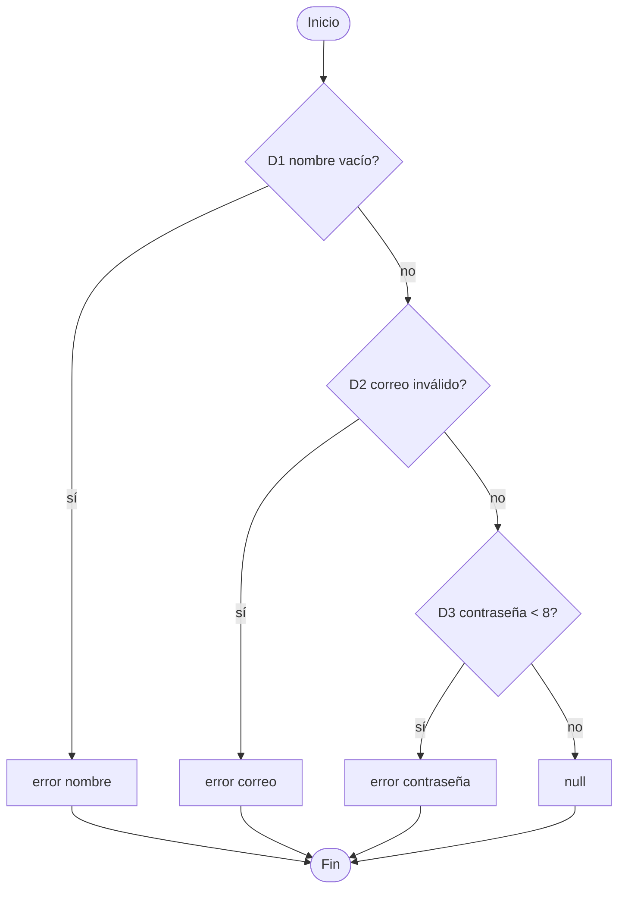
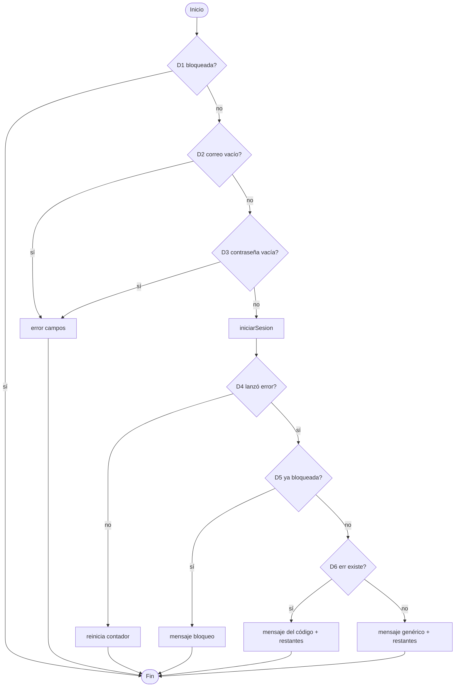

# Plan de pruebas de caja blanca: DocenGo

Las pruebas de caja blanca se diseñan leyendo el código, no solo los requisitos. En DocenGo se usan tres técnicas:

1. **Camino básico (McCabe):** se calcula la complejidad ciclomática V(G) y se escribe al menos una prueba por cada camino independiente.
2. **Cobertura de ramas y condiciones:** cada `if`, `? :`, `&&`, `||` y `?.` se prueba en sus dos resultados.
3. **Valores límite:** se prueba justo en el borde de cada comparación (`<`, `<=`, `>=`).

## Cómo calcular V(G)

```
V(G) = 1 + número de: if, ? :, &&, ||, ??, ?., case, for, while, catch
```

También con el grafo de flujo: `V(G) = aristas − nodos + 2`.

ESLint lo calcula por ustedes. Para ver el V(G) de cada función de un archivo:

```bash
npx eslint --rule 'complexity: [warn, 0]' src/lib/validacion.ts
```

La regla del proyecto (`eslint.config.js`) no deja subir funciones con V(G) mayor a 10.

## Criterios de aceptación

| Parte del código | Criterio | Cómo se verifica |
|---|---|---|
| `src/lib/` (lógica pura) | 100 % de ramas, líneas y funciones | `jest --coverage` falla si baja |
| Funciones de eventos en pantallas | Un caso por camino independiente, 80 % de ramas | Umbral en `package.json` (login) y revisión del PR |
| Cualquier función | V(G) ≤ 10 | `expo lint` |
| Ramas no alcanzables | Se documentan como hallazgo | Sección "Hallazgos" |

Los umbrales están en `package.json` → `jest.coverageThreshold`. El reporte se ve con `npm run test:cobertura` y abriendo `coverage/index.html`, o en GitHub en la pestaña **Actions** → artefacto **cobertura**.

---

## 1. `validarRegistro` (src/lib/validacion.ts), RF-05

```ts
export function validarRegistro(nombre, correo, contrasena) {
  if (!nombre.trim()) return 'Escribe tu nombre.';                    // D1
  if (!correoValido(correo)) return 'Escribe un correo válido.';      // D2
  if (contrasena.length < 8) return 'La contraseña debe tener...';    // D3
  return null;
}
```



**V(G) = 3 decisiones + 1 = 4.** Con el grafo: 10 aristas − 8 nodos + 2 = 4.

| Camino | Recorrido | Entrada | Resultado esperado | Prueba | Estado |
|---|---|---|---|---|---|
| C1 | D1 sí | nombre `"   "` | `'Escribe tu nombre.'` | CB-VAL-1 | Pasa |
| C2 | D1 no, D2 sí | correo `"ana@"` | `'Escribe un correo válido.'` | CB-VAL-2 | Pasa |
| C3 | D1 no, D2 no, D3 sí | contraseña de 7 caracteres (límite) | error de contraseña | CB-VAL-3 | Pasa |
| C4 | D1 no, D2 no, D3 no | contraseña de 8 caracteres (límite) | `null` | CB-VAL-4 | Pasa |

`correoValido` tiene V(G) = 1; se prueban sus dos resultados en CB-VAL-5 (válido, con espacios alrededor) y CB-VAL-6 (sin dominio, con espacio en medio).

## 2. Contador de intentos (src/lib/intentos.ts), RF-06

Las tres funciones tienen V(G) = 1. La comparación `fallidos >= MAX_INTENTOS` y `Math.max(0, ...)` se prueban en ambos resultados (cobertura de condiciones).

| Caso | Función | Entrada | Resultado esperado | Prueba | Estado |
|---|---|---|---|---|---|
| C1 | registrarFallo | 1.º y 2.º fallo | `bloqueada: false` | CB-INT-1 | Pasa |
| C2 | registrarFallo | 3.er fallo (límite) | `bloqueada: true` | CB-INT-2 | Pasa |
| C3 | registrarFallo | estado inicial | no lo modifica | CB-INT-3 | Pasa |
| C4 | intentosRestantes | 1 fallo | 2 | CB-INT-4 | Pasa |
| C5 | intentosRestantes | 5 fallos | 0, nunca negativo | CB-INT-5 | Pasa |
| C6 | registrarExito | — | contador en 0 | CB-INT-6 | Pasa |

## 3. `mensajeDeError` (src/lib/errores.ts)

```ts
return (codigo && MENSAJES[codigo]) || 'Ocurrió un error. Intenta de nuevo.';
//        D1          D2              D3 (||)
```

**V(G) = 1 + `&&` + `||` = 3.**

| Camino | Recorrido | Entrada | Resultado esperado | Prueba | Estado |
|---|---|---|---|---|---|
| C1 | código existe y está en la tabla | `'auth/invalid-credential'` | mensaje traducido | CB-ERR-1 | Pasa |
| C2 | código existe pero no está en la tabla | `'firestore/otro'` | mensaje genérico | CB-ERR-2 | Pasa |
| C3 | sin código | `undefined` | mensaje genérico | CB-ERR-3 | Pasa |

## 4. Distancias (src/lib/geo.ts), RF-17 y RF-19

| Función | V(G) | Técnica adicional |
|---|---|---|
| distanciaKm | 1 | Propiedades: mismo punto da 0, simetría |
| filtrarPorDistancia | 1 | Cobertura de ciclo (0 y varias iteraciones) y valor límite de `<=` |
| ordenarPorCercania | 1 | Verificar que no modifica la entrada |
| formatearDistancia | 2 (`? :`) | Valor límite en 1 km |

| Caso | Entrada | Resultado esperado | Prueba | Estado |
|---|---|---|---|---|
| C1 | mismo punto | 0 km | CB-GEO-1 | Pasa |
| C2 | Yuriria a Moroleón, ida y vuelta | entre 8 y 14 km, igual en ambos sentidos | CB-GEO-2 | Pasa |
| C3 | lista vacía | lista vacía (el ciclo no se ejecuta) | CB-GEO-3 | Pasa |
| C4 | un punto a menos de 5 km y otro lejos | solo el cercano | CB-GEO-4 | Pasa |
| C5 | punto exactamente a `maxKm` | se incluye | CB-GEO-5 | Pasa |
| C6 | tres puntos desordenados | del más cercano al más lejano | CB-GEO-6 | Pasa |
| C7 | arreglo original | sin cambios | CB-GEO-7 | Pasa |
| C8 | 0.85 km (rama sí de `? :`) | `'850 m'` | CB-GEO-8 | Pasa |
| C9 | 3.24 km (rama no) | `'3.2 km'` | CB-GEO-9 | Pasa |
| C10 | 1 km exacto (límite) | `'1.0 km'` | CB-GEO-10 | Pasa |

## 5. `opcionesVisibles` (src/lib/flags.ts), feature flags

```ts
opciones.filter((o) => !o.flag || flags[o.flag]);
//                      A         B
```

**V(G) de la función interna = 1 + `||` = 2.** Con cobertura de condiciones múltiples son 3 casos:

| Caso | A (`!o.flag`) | B (`flags[o.flag]`) | Resultado | Prueba | Estado |
|---|---|---|---|---|---|
| C1 | verdadero | no se evalúa | se muestra | CB-FLG-1 | Pasa |
| C2 | falso | verdadero | se muestra | CB-FLG-2 | Pasa |
| C3 | falso | falso | se oculta | CB-FLG-3 | Pasa |

## 6. `entrar()` en la pantalla de login (src/app/(auth)/login.tsx), RF-06

```ts
async function entrar() {
  if (intentos.bloqueada) return;                          // D1 (línea 18)
  if (!correo.trim() || !contrasena) { ...; return; }      // D2 || D3
  ...
  try {
    await iniciarSesion(correo, contrasena);               // éxito
    setIntentos(registrarExito());
  } catch (err) {                                          // D4
    const nuevo = registrarFallo(intentos);
    setError(nuevo.bloqueada                               // D5
      ? 'Cuenta bloqueada...'
      : `${mensajeDeError(err?.code)} ...`);               // D6 (?.)
  }
}
```



**V(G) = 1 + 6 decisiones = 7** (ESLint reporta 7).

| Camino | Recorrido | Entrada | Resultado esperado | Prueba | Estado |
|---|---|---|---|---|---|
| C1 | D1 sí | 4.º intento con cuenta bloqueada | no llama a Firebase | CB-LOG-1 | Pasa (ver H1) |
| C2 | D1 no, D2 sí | correo vacío | "Escribe tu correo y contraseña." | CB-LOG-2 | Pasa |
| C3 | D2 no, D3 sí | correo lleno, contraseña vacía | mismo mensaje | CB-LOG-3 | Pasa |
| C4 | D3 no, D4 no | credenciales correctas | sin error | CB-LOG-4 | Pasa |
| C5 | D4 sí, D5 no, D6 sí | contraseña incorrecta (1.er y 2.º intento) | "Intentos restantes: 2" y "1" | CB-LOG-5 | Pasa |
| C6 | D4 sí, D5 sí | 3.er intento incorrecto | "Cuenta bloqueada…" | CB-LOG-6 | Pasa |
| C7 | D4 sí, D5 no, D6 no | error sin objeto | mensaje genérico | CB-LOG-8 | Pasa |

Casos complementarios: CB-LOG-7 (un éxito reinicia el contador) y CB-LOG-9 (mientras espera, el botón muestra el indicador de carga).

## 7. `puedeEditar` (src/lib/permisos.ts), RF-13, RF-29 y RF-45

Decide si se muestran los botones **Editar** y **Eliminar**. Debe coincidir con la regla de Firestore `esAutor() || esAdmin()`: si la app y las reglas no coinciden, el usuario ve un botón que luego falla con `permission-denied`.

```ts
export function puedeEditar(autorId, actor) {
  if (!actor) return false;                                  // D1
  return actor.uid === autorId || actor.rol === 'admin';     // D2 (||)
}
```

**V(G) = 1 + `if` + `||` = 3.**

| Camino | Recorrido | Entrada | Resultado esperado | Prueba | Estado |
|---|---|---|---|---|---|
| C1 | D1 sí | sin sesión (`null`) | `false` | CB-PRM-1 | Pasa |
| C2 | D1 no, `uid === autorId` | el autor, rol docente | `true` (corto circuito del `\|\|`) | CB-PRM-2 | Pasa |
| C3 | D1 no, no es autor, es admin | otro uid, rol admin | `true` | CB-PRM-3 | Pasa |

Caso complementario (cobertura de condiciones): CB-PRM-4, ni autor ni admin → `false`.

## 8. Ficha de punto (RF-12): `contactoComoEnlace` y pantalla `punto/[id].tsx`

### 8.1 `contactoComoEnlace` (src/lib/contacto.ts)

```ts
export function contactoComoEnlace(contacto) {
  if (!contacto) return null;                                   // D1
  const digitos = contacto.replace(/\D/g, '');
  if (digitos.length === 10) return `tel:${digitos}`;           // D2
  if (contacto.includes('@')) return `mailto:${contacto.trim()}`; // D3
  return null;
}
```

**V(G) = 1 + 3 `if` = 4.**

| Camino | Recorrido | Entrada | Resultado esperado | Prueba | Estado |
|---|---|---|---|---|---|
| C1 | D1 sí | `undefined` o `''` | `null` | CB-CON-1 | Pasa |
| C2 | D1 no, D2 sí | `'445-123-4567'`, `'445 123 45 67'` | `'tel:4451234567'` | CB-CON-2 | Pasa |
| C3 | D2 no, D3 sí | `' renta@correo.com '` | `'mailto:renta@correo.com'` | CB-CON-3 | Pasa |
| C4 | D2 no, D3 no | `'Preguntar en la tienda'` | `null` | CB-CON-4 | Pasa |

Valor límite: CB-CON-5, 9 dígitos no se toma como teléfono.

### 8.2 Componente `Contenido` de la ficha (src/app/punto/[id].tsx)

```tsx
if (punto === undefined) return <Spinner/>;            // D1 cargando
if (punto === null) return <NoDisponible/>;            // D2 no existe
punto.descripcion || 'Sin descripción.'                // D3
punto.contacto ? <SeccionContacto/> : null             // D4
enlace ? <Boton/> : null                               // D5
enlace.startsWith('tel:') ? 'Llamar' : 'Escribir correo' // D6
editable ? <EditarPunto/> : null                       // D7 (agregada en T-02)
```

**V(G) = 1 + 7 = 8** (ESLint reporta 8). En T-01 era 7; T-02 agregó D7 para el botón **Editar punto**. Pruebas de componente con Firestore simulado (`jest.mock('../../src/services/db')`):

| Camino | Recorrido | Datos del punto | Resultado esperado | Prueba | Estado |
|---|---|---|---|---|---|
| C1 | D1 sí | todavía no llega | sin datos en pantalla | CB-FPT-4 | Pasa |
| C2 | D2 sí | no existe | "Este punto ya no está disponible." | CB-FPT-3 | Pasa |
| C3 | camino base: D3 con texto, D4 no, D5 no | con descripción, sin contacto | sin sección ni botón de contacto | CB-FPT-2 | Pasa |
| C4 | D4 sí, D5 sí, D6 tel | contacto `'445 123 4567'` | 4 datos + **Llamar** abre `tel:4451234567` | CB-FPT-1 | Pasa |
| C5 | D3 vacío, D6 correo | sin descripción, contacto correo | "Sin descripción." + **Escribir correo** | CB-FPT-5 | Pasa |
| C6 | D4 sí, D5 no | contacto `'Preguntar en la tienda'` | se muestra el texto, sin botón | CB-FPT-6 | Pasa |

| C7 | D7 sí (autor) | sesión del autor | aparece **Editar punto** y lleva a `/punto/editar/p1` | CB-FPT-7 | Pasa |
| C8 | D7 sí (admin) | sesión de admin, punto ajeno | aparece **Editar punto** | CB-FPT-9 | Pasa |

CB-FPT-8 confirma el lado falso de D7 con un docente que no es el autor. Las 9 pruebas cubren las 14 ramas (los dos lados de D1 a D7).

## 9. Registrar y editar puntos (RF-13)

### 9.1 `validarPunto` (src/lib/puntos.ts)

```ts
if (!p.nombre.trim()) return 'Escribe el nombre del punto.';                          // D1
if (!CATEGORIAS_PUNTO.includes(p.categoria)) return 'Elige una categoría.';            // D2
if (p.categoria === 'riesgo' && !p.descripcion.trim()) return 'Describe por qué...';  // D3 && D4
if (!dentroDeRegion(p)) return 'El punto está fuera de la región piloto.';            // D5
return null;
```


**V(G) = 1 + 4 `if` + 1 `&&` = 6.**

| Camino | Recorrido | Entrada | Resultado esperado | Prueba | Estado |
|---|---|---|---|---|---|
| C1 | D1 sí | nombre `'   '` | error de nombre | CB-PTO-1 | Pasa |
| C2 | D2 sí | categoría `'tienda'` | error de categoría | CB-PTO-2 | Pasa |
| C3 | D3 sí, D4 sí | riesgo, descripción `'  '` | error de descripción | CB-PTO-3 | Pasa |
| C4 | D3 no, D5 no | interés sin descripción | `null` | CB-PTO-4 | Pasa |
| C5 | D3 sí, D4 no, D5 sí | riesgo con descripción, lat 21.0 | error de región | CB-PTO-5 | Pasa |
| C6 | D3 sí, D4 no, D5 no | riesgo con descripción en Yuriria | `null` | CB-PTO-6 | Pasa |

La regla "riesgo exige descripción" (C3) apoya RF-31: toda zona de riesgo tendrá texto en su alerta.

### 9.2 `dentroDeRegion` (src/lib/puntos.ts), valores límite

`latMin ≤ latitud ≤ latMax && lonMin ≤ longitud ≤ lonMax`. **V(G) = 1 + 3 `&&` = 4.** Cada comparación se prueba en su borde exacto y 0.0001° afuera:

| Caso | Entrada | Resultado esperado | Prueba | Estado |
|---|---|---|---|---|
| Bordes exactos | (latMin, lonMax) y (latMax, lonMin) | `true` | CB-PTO-7 | Pasa |
| Latitud debajo | latMin − 0.0001 | `false` | CB-PTO-8 | Pasa |
| Latitud arriba | latMax + 0.0001 | `false` | CB-PTO-9 | Pasa |
| Longitud debajo | lonMin − 0.0001 | `false` | CB-PTO-10 | Pasa |
| Longitud arriba | lonMax + 0.0001 | `false` | CB-PTO-11 | Pasa |

### 9.3 `coordenadaDeParametros` (src/lib/puntos.ts)

Convierte los parámetros de la ruta `/punto/nuevo?lat=...&lon=...` en números. Protege contra un enlace mal formado.

`if (!lat || !lon || !Number.isFinite(latitud) || !Number.isFinite(longitud)) return null;` → **V(G) = 1 + `if` + 3 `||` = 5.**

| Camino | Condición que decide | Entrada | Resultado esperado | Prueba | Estado |
|---|---|---|---|---|---|
| C1 | todas falsas | `'20.21'`, `'-101.13'` | `{ 20.21, -101.13 }` | CB-PTO-12 | Pasa |
| C2 | `!lat` | `undefined` | `null` | CB-PTO-13 | Pasa |
| C3 | `!lon` | `''` | `null` | CB-PTO-14 | Pasa |
| C4 | latitud no es número | `'abc'` | `null` | CB-PTO-15 | Pasa |
| C5 | longitud no es número | `'xyz'` | `null` | CB-PTO-16 | Pasa |

### 9.4 `formularioInicial` (src/lib/puntos.ts)

Un `??` por campo más `inicial ?? {}`: **V(G) = 6.** Con dos casos se cubren los dos lados de los 5 `??`: CB-PTO-17 (sin valores, punto nuevo) y CB-PTO-18 (todos los valores, editar).

### 9.5 `guardar()` de FormularioPunto (src/components/FormularioPunto.tsx)

```ts
const problema = validarPunto(...);
if (problema) { setError(problema); return; }          // D1
try { await onGuardar({...textos sin espacios, latitud, longitud}); }
catch (err) { setError(mensajeDeError(err?.code)); }   // D2 catch, D3 ?.
```

**V(G) = 4.** Componente completo `FormularioPunto`: V(G) = 5 (antes 13, ver H3).

| Camino | Recorrido | Caso | Resultado esperado | Prueba | Estado |
|---|---|---|---|---|---|
| C1 | D1 sí | campos vacíos | error visible, `onGuardar` no se llama | CB-FRM-1 | Pasa |
| C2 | D1 no, sin excepción | nombre con espacios, Referencia, teléfono | se guarda sin espacios sobrantes y con la coordenada | CB-FRM-2 | Pasa |
| C3 | D2 sí, D3 err con código | Firestore responde `permission-denied` | "Ocurrió un error. Intenta de nuevo." | CB-FRM-3 | Pasa |

Casos complementarios: CB-FRM-4 (al elegir Riesgo la descripción se marca obligatoria), CB-FRM-5 (no se puede guardar dos veces mientras guarda), CB-FRM-6 (solo se usan latitud y longitud de `coordenada`; prueba de regresión del error encontrado al programar la edición).

### 9.6 Pantallas `punto/nuevo.tsx` y `punto/editar/[id].tsx`

| Pantalla | V(G) | Caso | Resultado esperado | Prueba | Estado |
|---|---|---|---|---|---|
| nuevo | 2 | coordenada inválida | "Ubicación no válida", sin formulario | CB-NVP-1 | Pasa |
| nuevo | 2 | coordenada válida | `crear('puntos', {..., autorId: 'u1'})` y regresa | CB-NVP-2 | Pasa |
| editar | 9 | docente que no es el autor | aviso, sin formulario | CB-EDP-1 | Pasa |
| editar | | el autor guarda | `actualizar` sin latitud ni longitud | CB-EDP-2 | Pasa |
| editar | | eliminar → Cancelar | no se borra | CB-EDP-3 | Pasa |
| editar | | eliminar → Eliminar | se borra y regresa al mapa | CB-EDP-4 | Pasa |
| editar | | el punto no existe | "Este punto ya no está disponible." | CB-EDP-5 | Pasa |
| editar | | cargando | sin formulario ni aviso | CB-EDP-6 | Pasa |
| editar | | admin con punto ajeno | formulario visible | CB-EDP-7 | Pasa |

---

## 15. Alertas (RF-30) — `src/lib/alertas.ts`

**`validarAlerta(borrador)`** — 5 decisiones → **V(G) = 6**

```
if (!tipo)                → 1
if (!nivel)               → 2
if (!localidad)           → 3
if (texto.length < 10)    → 4
if (texto.length > 280)   → 5
                    V(G) = 5 + 1 = 6
```

| Caso | Camino | Resultado esperado |
|---|---|---|
| CB-ALE-1 | Sin tipo | "Elige el tipo de alerta." |
| CB-ALE-2 | Sin nivel | "Elige el nivel de riesgo." |
| CB-ALE-3 | Sin localidad | "Elige la localidad." |
| CB-ALE-4 | Descripción de menos de 10 caracteres (los espacios no cuentan) | "Describe lo que pasó (mínimo 10 caracteres)." |
| CB-ALE-5 | Descripción de 281 caracteres | "La descripción no puede pasar de 280 caracteres." |
| CB-ALE-6 | Todo correcto, incluido el límite exacto de 280 | `null` |

**`armarAlerta(datos, coordenada, autorId, fecha)`** — sin decisiones → **V(G) = 1**

| Caso | Qué se comprueba |
|---|---|
| CB-ALE-7 | El documento lleva `autorId`, contadores en 0 y la descripción sin espacios sobrantes |

**Prueba manual (criterio del SRS):** registrar una alerta de cada nivel (alto, medio y bajo)
con una cuenta y verlas desde otra cuenta.

## 16. Confirmar y desmentir alertas (RF-34) — `src/lib/votos.ts`

Cada voto se guarda en `alertas/{alertaId}/votos/{uid}`. Como el id del documento es el uid,
cada docente tiene **un solo voto por alerta**: cambiar de opinión lo reemplaza y no lo duplica.
Las reglas de Firestore impiden que el autor vote su propia alerta y que alguien vote a nombre de otro.

**`contarVotos(votos)`** — 2 decisiones (`for`, `if`) → **V(G) = 3**

| Caso | Camino | Resultado esperado |
|---|---|---|
| CB-VOT-1 | Lista vacía: el ciclo no se ejecuta | 0 confirmaciones, 0 desmentidos |
| CB-VOT-2 | Votos mezclados: entra a ambos lados del `if` | 2 confirmaciones, 1 desmentido |

**`estadoAlerta(conteo)`** — 2 decisiones → **V(G) = 3**

| Caso | Camino | Resultado esperado |
|---|---|---|
| CB-VOT-3 | Nadie ha votado | Sin verificar |
| CB-VOT-4 | Más confirmaciones que desmentidos | Confirmada |
| CB-VOT-5 | Empate o más desmentidos | En duda |

**`puedeVotar(autorId, uid)`** — 1 decisión compuesta (`&&`) → **V(G) = 2**; condiciones múltiples = 3 casos

| Caso | Entrada | Resultado |
|---|---|---|
| CB-VOT-6 | Sin sesión / el autor / otro docente | `false` / `false` / `true` |

**`siguienteVoto(actual, elegido)`** — 1 decisión → **V(G) = 2**

| Caso | Entrada | Resultado |
|---|---|---|
| CB-VOT-7 | Mismo voto que ya tenía / el otro voto / sin voto previo | Se quita / se cambia / se guarda |

**Prueba manual (criterio del SRS):** con 3 cuentas, A crea una alerta, B confirma y C desmiente.
Después B cambia su voto: el conteo cambia sin que se dupliquen los votos. A no ve los botones en su alerta.

---

## Resumen de cobertura

Resultado de `npm run test:cobertura` (22 nov 2026):

| Archivo | Líneas | Ramas | Funciones |
|---|---|---|---|
| src/lib/errores.ts | 100 % | 100 % | 100 % |
| src/lib/flags.ts | 100 % | 100 % | 100 % |
| src/lib/geo.ts | 100 % | 100 % | 100 % |
| src/lib/intentos.ts | 100 % | 100 % | 100 % |
| src/lib/validacion.ts | 100 % | 100 % | 100 % |
| src/lib/permisos.ts | 100 % | 100 % | 100 % |
| src/lib/contacto.ts | 100 % | 100 % | 100 % |
| src/lib/puntos.ts | 100 % | 100 % | 100 % |
| src/lib/alertas.ts | 100 % | 100 % | 100 % |
| src/lib/votos.ts | 100 % | 100 % | 100 % |
| src/app/punto/[id].tsx, nuevo.tsx, editar/[id].tsx | 100 % | 100 % | 100 % |
| src/app/(auth)/login.tsx | 95 % | 94 % | 67 % |

En login.tsx quedan sin cubrir la rama de H1 y la función del enlace "Regístrate" (línea 72), que solo navega a otra pantalla.

Las demás pantallas aparecen en 0 % porque todavía no tienen pruebas. Cada responsable agrega las de su módulo.

## Hallazgos

| ID | Ubicación | Descripción | Decisión |
|---|---|---|---|
| H1 | login.tsx, línea 18 | El camino C1 (`intentos.bloqueada` verdadero) no se alcanza desde la interfaz: el botón se deshabilita al bloquear la cuenta, así que `entrar()` ya no se ejecuta. Es la única rama sin cubrir del archivo. | Se conserva como código defensivo. CB-LOG-1 verifica el comportamiento observable (Firebase no recibe un 4.º intento). |
| H2 | firestore.rules, regla general `match /{coleccion}/{id}` | La regla general también aplicaba a `usuarios`: un usuario podía crear su documento con `{ rol: "admin", autorId: <su uid> }` y quedar como administrador. Encontrado al revisar las reglas contra RF-43. | Corregido en T-00: la regla general excluye `usuarios` y `reportes`. Verificado en el Área de pruebas de reglas (create con rol admin → Denegado). |
| H3 | FormularioPunto.tsx | La regla `complexity` de ESLint rechazó el componente con V(G) = 13 (cuatro `??` en los `useState` y los chips de categoría dentro del mismo componente). | Refactorizado en T-02: valores iniciales en `formularioInicial` (src/lib, con pruebas) y chips en `SelectorCategoria`. V(G) bajó a 5. |
| H4 | punto/editar/[id].tsx | Al programar la edición se pasaba el punto completo como `coordenada`; al guardar, sus datos viejos (nombre, categoría) se esparcían después de los nuevos y los pisaban. Encontrado al revisar el código antes de probar. | Corregido en T-02: la pantalla pasa solo latitud y longitud y el formulario solo toma esas dos. Prueba de regresión CB-FRM-6. |

---

## Plantilla para una función nueva

Copien esto al final del documento en el mismo PR donde agregan la función.

```markdown
## N. `nombreFuncion` (ruta/del/archivo.ts), RF-XX

(código con las decisiones marcadas D1, D2, ...)

**V(G) = ...** (comprobar con `npx eslint --rule 'complexity: [warn, 0]' ruta/del/archivo.ts`)

| Camino | Recorrido | Entrada | Resultado esperado | Prueba | Estado |
|---|---|---|---|---|---|
| C1 | | | | CB-XXX-1 | |
```

Los nombres de las pruebas empiezan con su ID (`test('CB-XXX-1 ...')`) para encontrarlas con `npx jest -t CB-XXX`.
